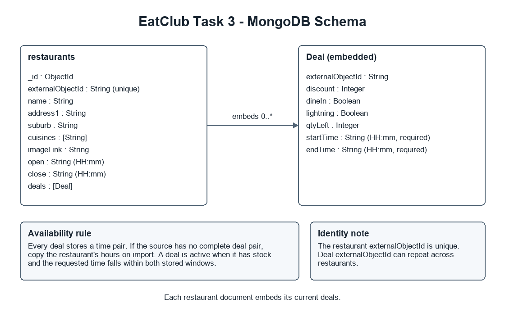

# Task 3 — MongoDB schema design

I chose MongoDB because EatClub supplies each restaurant with its own hours and a list of deals. Both endpoints need the restaurant's hours to determine when its deals are active. I would store one document per restaurant in a `restaurants` collection and embed its deals in a `deals` array. This keeps the hours and current deals together in one read per restaurant. The design assumes each restaurant has a small list of current deals. [MongoDB embedded data](https://www.mongodb.com/docs/manual/data-modeling/embedding/)

- Each restaurant has a MongoDB-generated `_id` of type `ObjectId` and a unique string `externalObjectId` from EatClub. The importer uses `externalObjectId` to match restaurants on refresh. Each embedded deal stores its source ID as `externalObjectId` and remains a separate array entry, including when IDs repeat.
- Store daily clock times as strings in `HH:mm` format at the feed's current precision. Restaurant `open` and `close` and deal `startTime` and `endTime` are required. On import, use a complete deal `open`/`close` pair first, then a complete `start`/`end` pair. If neither is complete, copy the restaurant's hours into the deal's time fields.
- A deal needs positive stock, and the requested time must fall within both stored windows. Opening is inclusive and closing is exclusive. An end time earlier than its start means the window crosses midnight. Java parses the stored values as `LocalTime` and uses minute indexes when calculating the peak. A future change to time precision can keep the same storage fields.
- Convert `discount` and `qtyLeft` to integers and `dineIn` and `lightning` to booleans on import. Serialize these values as strings in the Task 1 response to match the API contract.
- The EatClub feed also includes `cuisines` and `imageLink`. A future import would extend the current `SourceRestaurant` record or use a dedicated import record to retain those fields.

